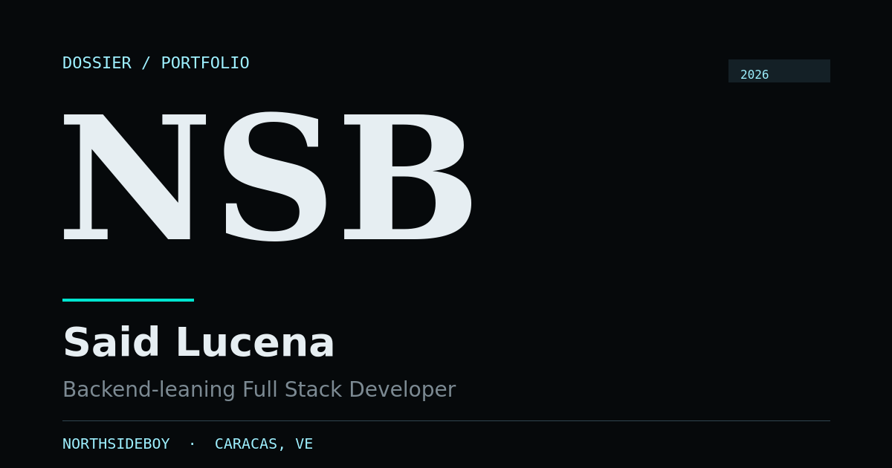
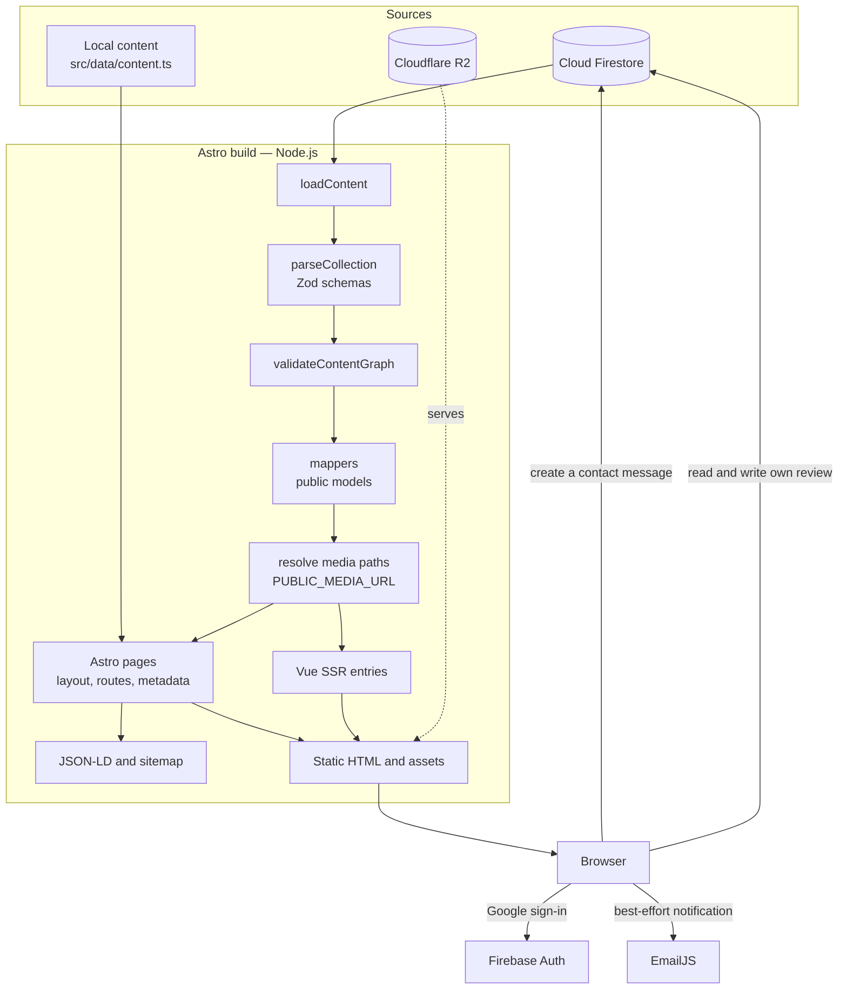

# Said Lucena — Portfolio

[](https://astro.build)
[](https://vuejs.org)
[](https://tailwindcss.com)
[](https://www.typescriptlang.org)
[](https://nodejs.org)
[](LICENSE)

A bilingual, statically generated engineering portfolio for **Said Lucena
(NorthSideBoy)**, a backend-leaning full-stack developer based in Caracas,
Venezuela.

Astro owns routing, layout, SEO and locally authored content. Vue renders
editorial content managed in Cloud Firestore during the build and hydrates only
the surfaces that need client state. Dynamic media is served from Cloudflare R2;
the repository keeps only static assets. The browser talks to Firebase for two
narrow purposes: one authenticated contact message and one owner-scoped visitor
review. There is no application server, no runtime content API and no
client-side query for public content.



---

## Table of contents

- [1. What this project is](#1-what-this-project-is)
- [2. Quick start](#2-quick-start)
- [3. Architecture](#3-architecture)
- [4. Repository layout](#4-repository-layout)
- [5. Rendering model and routes](#5-rendering-model-and-routes)
- [6. Editorial content model](#6-editorial-content-model)
- [7. Environment variables](#7-environment-variables)
- [8. Visitor flows](#8-visitor-flows)
- [9. Media and icons](#9-media-and-icons)
- [10. Security and privacy](#10-security-and-privacy)
- [11. SEO, internationalization and accessibility](#11-seo-internationalization-and-accessibility)
- [12. Development and verification](#12-development-and-verification)
- [13. Deployment and operations](#13-deployment-and-operations)
- [14. Troubleshooting](#14-troubleshooting)
- [15. Maintenance and documentation map](#15-maintenance-and-documentation-map)
- [16. Project status and license](#16-project-status-and-license)

---

## 1. What this project is

The portfolio presents a working engineering record rather than a service
brochure: identity, services, skills, stack, experience, selected projects,
education, certifications, technical writing, moderated visitor reviews and
contact channels. Projects, experiences and reviews are connected through stable
identifiers so a reader can move from a system to the role that produced it and
to the people who experienced the result.

Spanish is the primary language. English mirrors the interface and the
substantive content under `/en`. Both locales are generated from the same
validated content snapshot.

### Implemented capabilities

| Capability | Implementation |
| --- | --- |
| Static, prerendered site | Astro; no runtime rendering adapter |
| Bilingual routes | Spanish at `/`, English under `/en/` |
| Editorial content | Cloud Firestore, read once during the build |
| Content validation | Zod schemas plus cross-collection graph validation |
| Dynamic media | Cloudflare R2, resolved through `PUBLIC_MEDIA_URL` |
| Contact form | Google-authenticated, append-only write to a private collection |
| Visitor reviews | Google-authenticated, one owner-scoped document, manual approval |
| Email notifications | Best-effort EmailJS sends from the browser after the write |
| SEO | Canonical URLs, `hreflang`, Open Graph, Twitter Cards, JSON-LD, sitemap |
| Themes | Dark and light, persisted in `localStorage` before first paint |
| Motion | Authored entrances with `prefers-reduced-motion` fallbacks |
| Accessibility | Keyboard navigation, visible focus, semantic ARIA states, skip link |
| Testing | Zod/contract tests, architecture tests and Playwright browser tests |

### Non-goals

- No runtime server, serverless function or content endpoint.
- No browser query for public content.
- No `client:only` rendering for public pages.
- No admin/CMS UI. Approval is a manual Firestore operation.
- No analytics, newsletter or marketing automation.
- No built-in rate limiting. App Check or a backend would be required.
- No English CV is confirmed; only the Spanish PDF ships.

### Technology stack

| Area | Choice |
| --- | --- |
| Framework | Astro 7 |
| UI islands | Vue 3 with `<script setup lang="ts">` |
| Styling | Tailwind CSS 4 plus semantic design tokens |
| Validation | Zod 4 |
| Build-time data | Firebase Admin SDK and Cloud Firestore |
| Browser data | Firebase Authentication and Firestore Lite |
| Dynamic media | Cloudflare R2 through `@aws-sdk/client-s3` |
| Email | EmailJS browser SDK, loaded on submit |
| Unit and contract tests | Vitest 5 |
| Browser tests | Playwright with Chromium |
| Runtime | Node.js `26.13.0`, pinned by `mise.toml` |

---

## 2. Quick start

### Prerequisites

- **Node.js 26.13.0** (`>=26.13.0 <27`). With [mise](https://mise.jdx.dev/):
  `mise install`.
- **npm** (the repository commits `package-lock.json`).
- A **Firebase project** with Cloud Firestore enabled.
- **Credentials to read Firestore at build time**: either a service account or
  Application Default Credentials.
- A **public Cloudflare R2 bucket** (or any HTTPS media host) for dynamic media.
- Optional: **EmailJS** account for email notifications.

### Install and configure

```sh
npm install
cp .env.example .env
```

Fill `.env` with at least:

```dotenv
SITE_URL=http://localhost:4321
PUBLIC_MEDIA_URL=https://media.example.com
PUBLIC_FIREBASE_API_KEY=...
PUBLIC_FIREBASE_AUTH_DOMAIN=...
PUBLIC_FIREBASE_PROJECT_ID=...
PUBLIC_FIREBASE_APP_ID=...
```

Then provide Firestore credentials, either with
`FIREBASE_PROJECT_ID`, `FIREBASE_CLIENT_EMAIL` and `FIREBASE_PRIVATE_KEY`, or by
using Application Default Credentials:

```sh
gcloud auth application-default login
```

> [!IMPORTANT]
> Development and production builds read Cloud Firestore. Without valid
> credentials, `npm run dev` and `npm run build` fail when content is loaded.
> `CONTENT_SOURCE=fixture` is the only way to build without Firestore, and that
> build must never be deployed.

### Run

```sh
npm run dev
```

The Astro development server is available at `http://localhost:4321`.

For a production-like check:

```sh
npm run check
npm test
npm run build
```

### Environment file loading

The development, build, check and preview scripts run through
`node --env-file-if-exists=.env`, so `.env` values reach `process.env` before
Astro starts. This matters because `astro.config.mjs` reads `SITE_URL` at
configuration time.

See [Environment variables](#7-environment-variables) for the full contract.

---

## 3. Architecture

### Design constraints

The architecture follows from a small set of non-negotiable constraints:

1. **Public content must be in the initial HTML.** Search engines and
   no-JavaScript readers receive the managed records without a browser query.
2. **Editorial content belongs to Firestore.** Titles, projects, articles and
   approved reviews are managed outside the repository.
3. **Every public route is prerendered.** There is no runtime data source.
4. **JavaScript is shipped only for behaviour that needs it.** Static content
   stays server-rendered.
5. **Two runtime exceptions are deliberate.** The contact form appends a private
   `forms` document, and a visitor may read and write their own review.
6. **The browser never receives server credentials.** The Admin SDK stays in the
   build; the browser gets only public Firebase web configuration.

These constraints produce two independent decisions:

- **Provenance** — is the content local to the repository or managed in
  Firestore?
- **Interactivity** — does the surface need client state, events or browser
  APIs?

Keeping the decisions separate avoids the two common mistakes: hydrating content
that only needs to be printed, and moving managed content into Astro components
that duplicate the Firestore schema.

### Build-time data flow



### Content pipeline

`loadContent()` in [`src/lib/server/content.ts`](src/lib/server/content.ts) is
the single entry point for editorial data:

1. Rejects `public/images` or `public/files` if they exist, because those paths
   are reserved for dynamic media.
2. Reads ten Firestore collections in parallel.
3. Rejects an empty collection, except `reviews`, which may legitimately be
   empty on a new site.
4. Requires each document's `id` field to match its Firestore document ID.
5. Parses every document against its Zod schema in
   [`src/data/schemas/`](src/data/schemas/).
6. Validates cross-collection references with `validateContentGraph`.
7. Sorts records by `order`, keeps only published articles, and filters reviews
   to `approved == true`.
8. Maps documents to public models in [`src/data/mappers.ts`](src/data/mappers.ts).
9. Resolves `/images/...` and `/files/...` through `PUBLIC_MEDIA_URL`.
10. Rejects any media path that remains unresolved.

Production builds reuse one validated snapshot for the whole build, including
both locales and `getStaticPaths()`. Development reads Firestore on every
request. `CONTENT_SOURCE=fixture` substitutes deterministic local fixtures.

### The two rendering paths

| Content source | Needs client state or events? | Implementation |
| --- | --- | --- |
| `src/data/content.ts` | No | Astro component |
| `src/data/content.ts` | Yes | Astro component plus `src/scripts/*` |
| Firestore | No | Vue entry with no `client:*` directive |
| Firestore | Yes | Vue entry with the smallest `client:*` directive |
| SEO metadata or route structure | Either | Astro, always |

Astro also owns the document shell. Even when a title or description comes from
Firestore, the value is computed in the Astro route and passed to
[`src/layouts/Layout.astro`](src/layouts/Layout.astro) so the `<head>` is complete
before Vue runs.

### Cross-island contracts

Each hydrated island is a separate Vue root. There is no global Vue store, no
shared reactive object and no island-to-island event bus. Coordination uses
browser-level channels:

| Channel | Contract |
| --- | --- |
| Theme | `localStorage["sl-theme"]`, `<html data-theme="dark\|light">` |
| Locale | URL path: `/` or `/en/...` |
| Locale scroll handoff | `sessionStorage["sl-locale-scroll"]` |
| Review draft | `sessionStorage["sl-review-draft"]` |
| Section state | `window.location.hash` |
| Server-to-island data | Serialized props from Astro |

The inline script in `Layout.astro` applies the stored theme before first paint.
`src/scripts/site-chrome.ts` binds theme toggles, mobile navigation and hash
synchronization. `src/scripts/reveal.ts` explicitly skips `astro-island`
subtrees so static reveal animations never interfere with Vue-owned DOM.

---

## 4. Repository layout

```text
.
├── src/
│   ├── pages/                  File-based routes, Spanish and English
│   ├── layouts/                Document shell, SEO tags, theme bootstrap
│   ├── components/
│   │   ├── chrome/             Header, footer, locale switch, theme toggle
│   │   ├── home/               Home page sections (Astro and Vue)
│   │   ├── projects/           Projects index, tiles, carousel, relations
│   │   ├── blog/               Blog index, article renderers, embeds
│   │   ├── reviews/            Access, panel, card and invitation surfaces
│   │   ├── ui/                 Shared Astro/Vue primitives and icons
│   │   └── islands/            The only Vue entries Astro may import
│   ├── data/                   Local copy, contracts, schemas, relations, mappers
│   │   ├── schemas/            Zod collection contracts and graph validation
│   │   ├── articleUtils.ts     Locale-aware article selection
│   │   ├── content.ts          Local UI copy and section labels
│   │   ├── contact.ts          Contact limits, schema and payload builder
│   │   ├── reviews.ts          Review limits, draft validation and helpers
│   │   ├── relations.ts        Bidirectional project/experience/review links
│   │   └── anchors.ts          Stable deep-link IDs
│   ├── lib/
│   │   ├── server/             Build-only Firestore, fixtures, media, R2, icons
│   │   ├── firebase/           Lazy browser SDK entry points
│   │   ├── reviews/            Owner-scoped review repository and errors
│   │   ├── forms/              Append-only contact repository
│   │   ├── notifications/      EmailJS client and template builders
│   │   ├── auth/               Shared Google session helpers
│   │   ├── seo.ts              JSON-LD graph builders and serialization
│   │   ├── sitemap.ts          Sitemap entries and XML generation
│   │   └── withIslandContext.ts  Per-island locale, route and content context
│   ├── composables/            Google session, review draft/submission, contact
│   ├── router/                 Localized links and hash/scroll control
│   ├── scripts/                Progressive enhancement for Astro HTML
│   ├── stores/                 Persisted theme store
│   ├── styles/                 Font imports and global Tailwind entry
│   └── assets/                 Fonts, design tokens and processed images
├── public/                     Unprocessed static files (favicon, CV, OG card)
├── tests/                      Unit, contract, architecture and browser tests
├── docs/                       Architecture, conventions and how-to guides
├── firestore.rules             The Firestore security boundary
├── firestore.indexes.json      Index definitions (currently none)
├── firebase.json               Firestore and Auth provider configuration
├── astro.config.mjs            Static config, Vue integration, Tailwind plugin
├── vitest.config.ts            Test runner configuration
├── mise.toml                   Node version pin
└── package.json                Scripts and dependencies
```

### Component layout rule

Components are organized by feature first, then by render layer:

- `astro/` — components rendered entirely during the build.
- `vue/` — Vue implementation imported by another Vue component or an island.
- `lib/` — feature-specific non-component helpers, when needed.
- `islands/` — the only Vue entries an `.astro` file may import.

`src/components/islands/` is an **import boundary**, not a hydration boundary.
It may contain SSR-only entries (`*Content.vue`) and hydrated entries
(`*Island.vue`). Loose component files at the `src/components/` root are
forbidden.

The short local guide lives in
[`src/components/README.md`](src/components/README.md). The enforceable rules
live in [`docs/conventions.md`](docs/conventions.md).

---

## 5. Rendering model and routes

### Astro responsibilities

- Routes and page composition.
- Document shell, canonical URLs, `hreflang`, Open Graph, Twitter Cards, robots
  meta and JSON-LD.
- Locally authored content: hero, figures, about, services, skills, chrome and
  form copy.
- Progressive enhancement scripts for local interactions.
- The sitemap and `robots.txt`.

Astro renders the header and footer directly. There are no header or footer
islands.

### Vue responsibilities

Vue renders Firestore-managed content:

- Stack, experience, education, certifications and the blog teaser.
- The blog index and article bodies.
- The projects index, project cards and carousel.
- Visitor review cards and invitations.
- Review access, review panel and the contact form.

Only the last group needs hydration. Articles, the blog index, stack,
experience, education and certifications ship as HTML with no client directive.

### Hydration matrix

| Surface | Entry | Directive |
| --- | --- | --- |
| Projects index | `ProjectsIndexIsland.vue` | `client:load` |
| Home projects | `ProjectsIsland.vue` | `client:visible` (`rootMargin: 200px`) |
| Contact | `ContactIsland.vue` | `client:visible` (`rootMargin: 200px`) |
| Home reviews | `TestimonialsIsland.vue` | `client:idle` (`timeout: 1500`) |
| Review access | `ReviewsAccessIsland.vue` | `client:load` |
| Review panel | `ReviewPanelIsland.vue` | `client:load` |
| Stack | `StackContent.vue` | none |
| Experience | `ExperienceContent.vue` | none |
| Education | `EducationContent.vue` | none |
| Certifications | `CertificationsContent.vue` | none |
| Blog teaser | `BlogContent.vue` | none |
| Blog index | `BlogIndexContent.vue` | none |
| Article | `ArticleContent.vue` | none |

`client:only` is never used for public content because it gives up server HTML
and search visibility. Hydrated entries are wrapped with `withIslandContext`,
which provides locale/theme and route context, spreads the `content` object into
props and forwards slots. SSR-only, prop-driven entries may export their view
directly.

### Routes

Every public URL ends with a slash. `astro.config.mjs` sets
`trailingSlash: 'always'`, and the eventual host must mirror that behavior.

| Route | Locale | Purpose | Indexable |
| --- | --- | --- | --- |
| `/` | ES | Home with anchored sections | Yes |
| `/proyectos/` | ES | Projects index | Yes |
| `/blog/` | ES | Blog index | Yes when at least one article exists |
| `/blog/:slug/` | ES | Article, only for existing Spanish translations | Yes |
| `/en/` | EN | Home | Yes |
| `/en/projects/` | EN | Projects index | Yes |
| `/en/blog/` | EN | Blog index | Yes when at least one article exists |
| `/en/blog/:slug/` | EN | Article, only for existing English translations | Yes |
| `/resenas/` | ES | Review access | `noindex, follow` |
| `/resenas/panel/` | ES | Review submission panel | `noindex, follow` |
| `/en/reviews/` | EN | Review access | `noindex, follow` |
| `/en/reviews/panel/` | EN | Review submission panel | `noindex, follow` |
| `/projects` | — | Permanent redirect to `/proyectos/` | — |
| `/en/proyectos/` | — | Permanent redirect to `/en/projects/` | — |
| `/en/resenas/` | — | Permanent redirect to `/en/reviews/` | — |
| `/en/resenas/panel/` | — | Permanent redirect to `/en/reviews/panel/` | — |
| `/404` | ES | Not found page | `noindex` |
| `/sitemap-index.xml` | — | Sitemap index | — |
| `/sitemap-0.xml` | — | Generated URL set | — |
| `/robots.txt` | — | Crawler policy and sitemap pointer | — |

Articles are generated only for locales that have a translation. An article
without English content stays in the Spanish blog and produces no English
fallback route or cross-language card.

### Theme, locale and deep links

- **Theme:** stored under `sl-theme`; applied by an inline script before first
  paint; toggled through `[data-theme-toggle]`.
- **Locale:** a real navigation, not in-memory state. `LocaleSwitch.astro`
  renders the links; `site-chrome.ts` stores the scroll offset in
  `sessionStorage["sl-locale-scroll"]` and preserves the current hash before
  navigating.
- **Deep links:** the URL hash is the shared section state. Header navigation
  rewrites it with `history.replaceState`; `scrollControl.ts` pauses that rewrite
  during a deep-link scroll. `TestimonialsSection.vue` expands hidden review
  cards before following a `#review-...` target.
- **Storage access:** every `localStorage` or `sessionStorage` call is guarded;
  disabled storage must not break the page.

### Progressive enhancement scripts

`src/scripts/` contains framework-free enhancements for Astro-rendered
surfaces: header navigation, theme controls, locale scroll restoration, stat
counters, the identity plate, skill tabs, email copy and article navigation.

Scripts follow a shared contract:

- Select behaviour hooks with `data-*` attributes, not presentation classes.
- Leave the server HTML intact when JavaScript is unavailable.
- Guard browser APIs and `prefers-reduced-motion`.
- Clean up listeners and observers on `pagehide` when they own long-lived work.
- Never mutate nodes inside `astro-island`; Vue owns those subtrees.

---

## 6. Editorial content model

Firestore is the source of truth for editorial content. The build reads ten
collections; `forms` is a runtime-only collection and is never part of the
content graph.

| Collection | Purpose | Key relationships |
| --- | --- | --- |
| `siteSections` | Localized section copy and index metadata | Exactly seven fixed IDs |
| `authors` | Article author profiles | Referenced by `articles.authorId` |
| `stackGroups` | Stack categories and ordering | Referenced by `technologies.stackGroupId` |
| `technologies` | Stack entries and technology metadata | Referenced by experience and project `tech[].id` |
| `experience` | Roles, periods, outcomes and tech | Referenced by projects and reviews |
| `projects` | Case records, media, links and code excerpts | `experienceIds`, `tech`, review `projectSlugs` |
| `education` | Education ledger | Standalone, ordered |
| `certifications` | Certification ledger | Standalone, ordered |
| `articles` | Bilingual technical writing | `authorId`, optional `translations.es/en` |
| `reviews` | Editorial and visitor testimonials | `experienceIds`, `projectSlugs`; approved only |
| `forms` | Private contact messages | Runtime writes only; never read in the build |

### Fixed section IDs

`siteSections` must contain exactly these seven documents, each with Spanish and
English copy:

```text
stack, experience, projects, education, certifications, blog, reviews
```

Projects, blog and stack have extra copy requirements. Projects and blog require
index metadata; stack requires a note.

### Validation rules

The build fails before writing pages when content is invalid. Validation covers:

- **Collection shape.** Each collection is parsed with its Zod schema.
- **Non-empty collections.** Every collection except `reviews` must contain at
  least one document.
- **Document identity.** `data.id` must equal the Firestore document ID.
- **Section completeness.** Exactly seven `siteSections`, with no duplicates or
  missing IDs.
- **Unique order.** `order` values must be unique within a collection.
- **Relations.** Project tech, experience tech, stack group IDs, article authors,
  project experiences and review relations must resolve.
- **Highlight limit.** At most one experience may have `highlight: true`.
- **Static anchors.** Review `anchorId` values must be unique.
- **Firestore shape.** Nested arrays are rejected because Firestore Standard
  does not support them.
- **Article rules.** At least one translation; unique block IDs; reserved heading
  anchors rejected; valid tables, embeds, galleries and footnotes; at most one
  footnotes block, and it must be last.
- **Project rules.** No duplicate technologies; projects with multiple links
  require exactly one primary link.
- **Review rules.** Visitor review IDs equal the author UID; editorial reviews
  cannot claim a UID; at most three relations in total.

An invalid graph produces one error listing every issue found, which is usually
faster to fix than stopping at the first failure.

### Articles

Articles use a closed block vocabulary:

```text
heading, paragraph, quote, list, code, image, gallery, callout,
divider, table, embed, file, footnotes
```

A document carries `id`, `order`, `updatedAt`, `cover`, `authorId`, optional
`featured`, and one or both locale translations. `status` is `published` or
`draft`; only published articles reach the site or the sitemap. `updatedAt` must
not precede `publishedAt`.

Embeds are limited to YouTube, Vimeo, CodePen and CodeSandbox, and the URL host
must match the declared provider. Article code blocks are capped at 100,000
characters; a translation may contain up to 500 blocks.

### Projects

A project records its workplace context, role, stack, media and evidence. Media
is one of:

- `cover` — theme-specific dark and light images with bilingual alt text.
- `logo` — a single image with an optional surface preference.
- `monogram` — a text label when no image exists.

Private systems use schematic artwork, not invented screenshots. A `demo` link
renders only when a real public URL exists. Project code excerpts are optional
and rendered inside a closed native `<details>` disclosure.

### Reviews

Reviews are validated twice: by Zod at the build boundary and by Firestore Rules
at the write boundary. Shared limits live in `REVIEW_LIMITS`:

| Field | Limit |
| --- | --- |
| Quote | 40–400 characters |
| Roles | 1–3, each 2–60 characters |
| Relations | At most 3 experiences plus projects in total |
| Public anchor | Kebab-case, at most 40 characters |
| Google photo URL | HTTPS `*.googleusercontent.com`, at most 4,096 characters |
| Photo display policy | 10 MB applies only to a future upload/proxy path |

The public review model is intentionally narrow. `toPublicTestimonial` keeps the
author name, roles, photo, quote and email, and strips approval, ownership,
source and ordering fields.

### Contact messages

`forms` stores `senderUid`, `name`, `email`, `subject`, `message`, `locale` and a
server timestamp. Name and email are **not form fields**: they come from the
signed-in Google account. Subject and message are trimmed and validated before
the write.

| Field | Limit |
| --- | --- |
| Name | 1–80 characters |
| Email | Up to 254 characters |
| Subject | 3–120 characters |
| Message | 10–2,000 characters |

---

## 7. Environment variables

`PUBLIC_*` values are compiled into the browser bundle. They are public by
design and must never contain a secret.

| Variable | Scope | Required | Purpose |
| --- | --- | --- | --- |
| `SITE_URL` | Build | **Yes** | Canonical domain for canonical URLs, `hreflang`, Open Graph and sitemap. The build fails without it. |
| `PUBLIC_MEDIA_URL` | Build and browser | **Yes** | Public HTTPS base URL for R2 media. The build fails if missing or non-HTTPS. |
| `FIREBASE_PROJECT_ID` | Build (server) | Conditional | Firebase project for the Admin SDK. Defaults to `northsideboy-portfolio` if unset. |
| `FIREBASE_CLIENT_EMAIL` | Build (server) | Conditional | Service-account email. Must be set together with the private key. |
| `FIREBASE_PRIVATE_KEY` | Build (server) | Conditional | Service-account private key, with escaped `\n` newlines. |
| `PUBLIC_FIREBASE_API_KEY` | Browser | **Yes** | Public Firebase web configuration. |
| `PUBLIC_FIREBASE_AUTH_DOMAIN` | Browser | **Yes** | Public Firebase Auth domain. |
| `PUBLIC_FIREBASE_PROJECT_ID` | Browser | **Yes** | Public Firebase project ID. |
| `PUBLIC_FIREBASE_APP_ID` | Browser | **Yes** | Public Firebase web app ID. |
| `PUBLIC_EMAILJS_PUBLIC_KEY` | Browser | Optional | EmailJS public key. |
| `PUBLIC_EMAILJS_SERVICE_ID` | Browser | Optional | EmailJS service ID. |
| `PUBLIC_EMAILJS_CONTACT_TEMPLATE_ID` | Browser | Optional | Contact notification template. |
| `PUBLIC_EMAILJS_REVIEW_TEMPLATE_ID` | Browser | Optional | Review notification template. |
| `R2_ACCOUNT_ID` | Server | No | Cloudflare account ID for future media CRUD. |
| `R2_ACCESS_KEY_ID` | Server | No | R2 access key for future media CRUD. |
| `R2_SECRET_ACCESS_KEY` | Server | No | R2 secret for future media CRUD. |
| `R2_BUCKET` | Server | No | R2 bucket name for future media CRUD. |
| `CONTENT_SOURCE` | Build | Test only | Set to `fixture` to build from local fixtures without Firestore. Never deploy that build. |

### Notes on credentials

- **Server credentials never reach the browser.** The Admin SDK lives in
  `src/lib/server/` and is imported only during the build.
- **If the three `FIREBASE_*` values are absent**, the build falls back to
  Application Default Credentials.
- **If only one of `FIREBASE_CLIENT_EMAIL` or `FIREBASE_PRIVATE_KEY` is set**,
  the build throws an explicit error.
- **The four public Firebase values are required by any build that renders the
  contact island**, because the island's module graph loads the Firebase web
  configuration. `npm run build:fixture` supplies placeholders.
- **A missing EmailJS value skips that notification.** Contact and review
  templates are configured independently.
- **The EmailJS private key is never used and must never be shipped.**
- **R2 S3 credentials are not read by the current build.** They exist for a
  future media CRUD path.

The public Firebase web configuration can be retrieved with:

```sh
npx firebase-tools apps:sdkconfig web
```

See [`.env.example`](.env.example) for inline documentation.

---

## 8. Visitor flows

### Shared Google session

The contact form and the review pages share one Firebase Authentication session.
Signing in or out on either surface applies to the other after hydration. The
session is resolved by
[`src/composables/useGoogleSession.ts`](src/composables/useGoogleSession.ts)
through lazy Firebase imports.

- Sign-in uses a Google popup.
- If the popup is blocked or unsupported, the flow falls back to a redirect.
- `prompt: 'select_account'` lets the visitor switch accounts.
- The Firebase web SDK is loaded dynamically and never executes during SSR.

### Contact form

1. The visitor reaches the home contact section, hydrated with
   `client:visible`.
2. The form shows a Google sign-in prompt until the shared session is ready.
3. After sign-in, the account name, photo and email appear as read-only identity.
4. The visitor writes a subject and message. Zod validates both in the browser.
5. On submit, Firestore Lite, the forms repository and EmailJS are imported
   dynamically.
6. The browser appends one document to `forms`, bound to the authenticated UID
   and token email.
7. Only after Firestore confirms the write does the UI show success.
8. The email notification is best effort. A failed or slow send does not repeat
   the write, reject the submission or change the success state.
9. Visitors who prefer not to sign in can still use the email, WhatsApp and
   GitHub links beside the form.

Messages are private. The browser cannot read, list, update or delete them; the
owner reads them in the Firestore Console or through the Admin SDK.

### Visitor reviews

1. The visitor opens `/resenas/` (or `/en/reviews/`) and continues with Google.
   If already signed in from the contact form, the session is reused.
2. At `/resenas/panel/` (or `/en/reviews/panel/`), the visitor writes roles, an
   optional relation and a review, then sees a live preview using the same card
   as the home page.
3. The review language is inherited silently from the current portfolio locale.
   There is no language selector.
4. On submit, the browser writes `reviews/{uid}` with `approved: false`.
5. While pending, the owner may edit the review. The document ID, anchor,
   creation time and approval flag are immutable.
6. Moderation happens outside the site: open Firestore → `reviews`, review the
   document, and set `approved: true`. Optionally set `order` to pin the
   position.
7. Run the normal build and deploy. The next static build queries only approved
   reviews and publishes them on the home, project and experience surfaces.
8. Deleting a review from the browser is not allowed.

Older editorial review rows without `approved` are excluded by the build query,
so no migration is required to hide them.

### Email notifications

Both flows notify by email **after** the Firestore write, from the browser, with
no notification server. Templates receive:

| Flow | Variables |
| --- | --- |
| Contact | `name`, `email`, `subject`, `locale`, `message` |
| Review | `author_name`, `author_email`, `roles`, `locale`, `relations`, `quote` |

Lists such as roles and relations are rendered as readable text. The recipient
is fixed inside EmailJS, never supplied by the browser. If the visitor closes the
tab immediately after submitting, the document is stored but the notification
may be skipped.

---

## 9. Media and icons

### Static assets

Static assets stay in the repository:

- `src/assets/` — images and fonts processed by Vite.
- `public/` — unprocessed files copied as-is, such as `/favicon.svg`,
  `/favicon.ico`, `/og-default.png` and `/cv/said-lucena-cv.pdf`.
- `public/images/` and `public/files/` are **reserved** for dynamic media and
  must not exist. The build fails if they appear.

### Dynamic media

Firestore stores relative paths such as `/images/projects/example-dark.png` or
`/files/articles/example.pdf`. The build prepends `PUBLIC_MEDIA_URL`. Absolute
R2 URLs are never stored in Firestore.

Dynamic media covers project images, article covers and diagrams, article files
and editorial review photos. Changing from an `r2.dev` domain to a custom domain
requires only updating `PUBLIC_MEDIA_URL`.

The minimal S3 client in [`src/lib/server/r2.ts`](src/lib/server/r2.ts) is
server-only scaffolding for a future media CRUD path. The current build does not
import it.

### Technology icons

Stack technology marks are resolved at build time:

1. `customIcon` — an optional lowercase `/images/...svg` path served from R2 and
   rendered as a CSS mask with `mask-image`, so it inherits `currentColor` and
   the tile's hover color.
2. `icon` — a library key resolved against Simple Icons by normalizing the key
   and taking the first scored slug or title match.
3. `FileCode2` — the generic fallback when neither works.

`customIcon` takes precedence over `icon` and is authoritative: if it is
unavailable, the tile does not substitute the library icon. In production
builds, the build HEAD-checks every custom icon. A missing object, non-SVG
response, CORS failure or network error logs a warning and falls back to
`FileCode2`.

R2 convention for custom marks:

```text
Key:            images/tech-icons/<slug>.svg
Content-Type:   image/svg+xml
Cache-Control:  public, max-age=31536000, immutable
CORS:           GET and HEAD from the site origin
```

SVGs must use a transparent background, a `0 0 24 24` viewBox, and no scripts,
`foreignObject`, event attributes or external references. The mask uses the SVG
alpha, so a custom mark renders monochrome.

`node`, `fish`, `jwt` and `playwright` are current custom marks because the first
Simple Icons match is wrong or unavailable. Full workflow:
[`docs/guides/tech-icons.md`](docs/guides/tech-icons.md).

### UI icons

UI glyphs are Lucide icons rendered through the twin primitives
`src/components/ui/astro/UiIcon.astro` and
`src/components/ui/vue/UiIcon.vue`.

- The public vocabulary lives in `src/components/ui/icon-names.ts`.
- Both wrappers expose the same set through `icon-map.ts` files, checked against
  `UiIconName`.
- `UiIcon` is decorative by contract: `aria-hidden="true"` and
  `focusable="false"`. The accessible name belongs on the control.
- A new inline `<svg>` is not accepted; add the name to the vocabulary and both
  maps.

Brand marks for GitHub, Google and WhatsApp come directly from `simple-icons`.
Simple Icons is CC0; the marks remain trademarks of their owners.

---

## 10. Security and privacy

### Firestore rules

[`firestore.rules`](firestore.rules) is the write boundary. The Admin SDK
bypasses rules during the build; every browser operation is checked.

| Collection | Browser permission |
| --- | --- |
| `reviews/{reviewId}` | `get` only for the signed-in owner (`reviewId == request.auth.uid`) |
| `reviews` | `list` denied |
| `reviews/{reviewId}` | `create` for a verified Google user, with `id == uid`, `approved == false` and validated fields |
| `reviews/{reviewId}` | `update` only while the stored review is still unapproved and owned by the caller |
| `reviews/{reviewId}` | `delete` denied |
| `forms/{messageId}` | `create` only for a verified Google account whose UID and email match the document |
| `forms/{messageId}` | `get`, `list`, `update`, `delete` denied |
| Everything else | Denied |

Additional guarantees:

- The review author's `provider` must be `Google`.
- Google photo URLs must be HTTPS and end in `.googleusercontent.com`.
- Review creation and update timestamps must be recent, limiting replay.
- The client writes identity fields once. The rules enforce immutable
  `createdAt` and `order` and reject any approval change.
- A client can never write `approved: true`.
- Contact messages require a recent server timestamp and are append-only.

### What is public

| Data | Visibility |
| --- | --- |
| Editorial content | Public in static HTML |
| Approved review quote, name, roles, photo | Public in static HTML |
| Approved review email | **Public** as a `mailto:` link, by design |
| Pending review content | Private to the owner and the Admin SDK/Console |
| Contact messages | Private; Admin SDK/Console only |
| Firebase web configuration | Public in the bundle |
| EmailJS public key, service and template IDs | Public in the bundle |
| Service-account credentials | Build only; never shipped |
| R2 S3 credentials | Server only; unused by the current build |

The review email is intentionally published so a reader can contact the author.
It is PII and therefore scrapeable. Do not add other private fields to the
public review model.

### Operational hardening

The current rules constrain payload shape, not request rate. Before exposing the
forms to significant traffic:

- Enable **Firebase App Check** for the web app.
- Configure **usage alerts** and budget alerts in Google Cloud.
- Add a hosting-level WAF or bot rule if the provider supports it.
- Consider a backend or App Check enforcement if abuse appears.

For Google popup sign-in:

- Add `localhost` and the production domain to **Firebase Authentication →
  Settings → Authorized domains**.
- If the host sends `Cross-Origin-Opener-Policy`, use
  `same-origin-allow-popups`.
- A Content Security Policy must allow:
  - `identitytoolkit.googleapis.com`
  - `securetoken.googleapis.com`
  - `firestore.googleapis.com`
  - `<project-id>.firebaseapp.com`
  - `accounts.google.com`
  - `*.googleusercontent.com`
  - `https://api.emailjs.com` in `connect-src` if EmailJS is enabled

### Secrets checklist

- Never commit `.env` or a service-account JSON file.
- Never place the EmailJS private key in a `PUBLIC_*` variable.
- Never import `src/lib/server/r2.ts` from client code.
- Never render visitor content with `v-html` or `set:html`.
- Never store raw SVG markup in Firestore.
- Never log contact messages, review text or EmailJS payloads.

---

## 11. SEO, internationalization and accessibility

### Metadata

`src/layouts/Layout.astro` emits:

- `<html lang>` and the initial theme.
- Title and meta description.
- Robots directives.
- Canonical URL for indexable pages.
- `hreflang` alternates (`es`, `en`, `x-default`) when both locales exist.
- Open Graph and Twitter Card metadata.
- Article publication and modification times.
- JSON-LD generated by [`src/lib/seo.ts`](src/lib/seo.ts).

JSON-LD builders cover `WebSite`, `Person`, `ProfilePage`, `BlogPosting`,
`CollectionPage` and `BreadcrumbList`. Structured data describes only visible
content; ratings or properties the page does not show are not added.

### Sitemap and robots

The sitemap is generated from the same validated content snapshot used for the
pages:

- `/sitemap-index.xml` is the public entry point.
- `/sitemap-0.xml` contains canonical, indexable URLs.
- Articles carry `lastmod` from `updatedAt`.
- Bilingual pages emit `xhtml:link` alternates.
- `noindex` pages, redirects and missing translations are excluded.
- Review routes never enter the sitemap.

`robots.txt` allows crawling, points to the sitemap, and disallows `/admin/` and
`/api/`. Those paths are reserved for future work and do not exist today.

### Internationalization

- Spanish is the default, unprefixed route.
- English lives under `/en`.
- Every public URL ends with a slash.
- Vue links use `toHref` or `RouterLink` from `src/router/astroRouter.ts`, never
  hand-built English paths.
- A locale switch is a real navigation that preserves the current hash and
  restores the reading position.
- Translated text carries the correct `lang` attribute.
- Reviews are not translated. Each review records the portfolio locale at
  publish time and renders its quote with that `lang`.
- Blog indexes are locale-scoped; articles exist only where a translation exists.

### Accessibility

The project aims to preserve accessible behaviour rather than claim formal
certification:

- One `main#main` per page and a global skip link.
- Keyboard access for the mobile menu, skill tabs, project filters, theme
  controls, disclosures and forms.
- Visible focus and deliberate focus management for menus, panels and deep links.
- Semantic states: `aria-expanded`, `aria-selected`, `aria-pressed`,
  `aria-controls`, `aria-current`, `aria-live` and `hidden`.
- Motion runs only under `prefers-reduced-motion: no-preference` or an explicit
  check, and content remains usable when motion is disabled.
- Both themes are composed, not inverted. Contrast should be verified in both.

No formal WCAG conformance level is declared. Treat accessibility as a
maintenance requirement and verify changes in both themes and with a keyboard.

---

## 12. Development and verification

### npm scripts

| Script | What it does |
| --- | --- |
| `npm run dev` | Astro dev server with `.env`; reads Firestore per request |
| `npm run build` | Production static build into `dist/` |
| `npm run check` | Astro and TypeScript diagnostics |
| `npm test` | Vitest unit and contract tests, excluding browser tests |
| `npm run test:browser` | Builds the fixture site, then runs Playwright tests |
| `npm run build:fixture` | Deterministic build with local fixtures |
| `npm run preview` | Serves the built site locally |
| `npm run astro` | Raw Astro CLI passthrough |

### Test suites

| File | Coverage |
| --- | --- |
| `tests/architecture.test.ts` | Astro/Vue import boundary, provenance split, naming, hydration guarantees, no Firebase in public features, review-route sitemap exclusion |
| `tests/content.test.ts` | Public models, approved-only review output, published email contract |
| `tests/fixtures.test.ts` | Fixture shape and validity against every collection schema |
| `tests/reviews.test.ts` | Review schema, public projection, draft validation, helpers, Firebase error mapping |
| `tests/contact.test.ts` | Contact schema, limits, trimming, payload building, session identity, rules alignment |
| `tests/notifications.test.ts` | EmailJS payloads, dynamic import, public-identifier contract |
| `tests/seo.test.ts` | JSON-LD builders, serialization and sitemap metadata |
| `tests/navigation.test.ts` | Localized link generation and trailing slashes |
| `tests/islands.test.ts` | Per-island context and slot forwarding |
| `tests/icons.test.ts` | UI icon vocabulary parity and brand icon contracts |
| `tests/techIcons.test.ts` | Simple Icons resolution, custom icon header checks and fallbacks |
| `tests/browser.test.ts` | No-JavaScript HTML, hydration, filters, theme persistence, locale navigation, deep links, keyboard access, review shells |

### Fixture builds

`npm run build:fixture` builds the whole site with deterministic content and
placeholder service values, without Firestore. It sets:

```text
CONTENT_SOURCE=fixture
PUBLIC_MEDIA_URL=https://media.example.test
SITE_URL=https://fixture.example.test
PUBLIC_FIREBASE_*   (fixture placeholders)
PUBLIC_EMAILJS_*    (empty)
```

That build is for verification only and must never be deployed.

### Browser tests

Browser tests require Chromium for Playwright. If it is not installed:

```sh
npx playwright install chromium
```

Then:

```sh
npm run test:browser
```

The script automatically runs `build:fixture` first, serves the static output,
and exercises the real generated site.

### Recommended local check

```sh
npm run check
npm test
npm run test:browser
npm run build
```

`npm run build` is the production build and requires real Firestore access.

---

## 13. Deployment and operations

### Build and hosting

The project produces a static site in `dist/`. No Astro adapter is configured,
so no runtime rendering or serverless function is required.

The host must provide:

- HTTPS.
- Trailing-slash behavior consistent with `trailingSlash: 'always'`.
- The ability to set the environment variables at build time.
- Optional: security headers compatible with Google sign-in and EmailJS.

Deploy the contents of `dist/` after a successful production build. This
repository does not commit a provider-specific hosting configuration; the host
is an operational choice, not an architectural requirement.

### Firebase setup

1. Create a Firebase project and enable Cloud Firestore.
2. Enable the Google sign-in provider:

   ```sh
   npx firebase-tools deploy --only auth
   ```

   The provider configuration lives in [`firebase.json`](firebase.json).

3. Add authorized domains for `localhost` and production.
4. Publish the Google OAuth consent screen before opening the flow to external
   visitors.
5. Deploy the security rules:

   ```sh
   npx firebase-tools deploy --only firestore:rules
   ```

6. Seed all nine required editorial collections. `reviews` may stay empty.

### Release checklist

- [ ] `SITE_URL` points to the production origin.
- [ ] `PUBLIC_MEDIA_URL` is HTTPS and reachable.
- [ ] Firestore service credentials or ADC are available to the build.
- [ ] Public Firebase values belong to the production project.
- [ ] Authorized domains include the production host.
- [ ] Firestore Rules are deployed.
- [ ] EmailJS origin and recipient are configured, if notifications are enabled.
- [ ] `npm run check`, `npm test` and `npm run test:browser` pass.
- [ ] `npm run build` succeeds against real content.
- [ ] The build is not a fixture build.
- [ ] The sitemap and `robots.txt` resolve on the deployed domain.

### Review moderation

1. Open Firestore → `reviews`.
2. Inspect the pending document.
3. Set `approved: true`.
4. Optionally set `order` to control placement.
5. Trigger a build and deploy.
6. Verify the review on the home, project and experience surfaces.

Approval is asynchronous with respect to the static site: nothing appears until
the next build. A CMS and deploy hook are **not implemented**.

### Rollback

There is no runtime application state to roll back. A previous static deployment
can be restored by redeploying its build artifact. Firestore content changes are
independent of the deployed HTML and require a new build to appear.

---

## 14. Troubleshooting

| Symptom | Likely cause | Fix |
| --- | --- | --- |
| `SITE_URL is required` | Missing environment value | Set `SITE_URL` in `.env` and in the build environment. |
| `PUBLIC_MEDIA_URL is required` | Missing media base URL | Set an HTTPS media URL. |
| `PUBLIC_MEDIA_URL must use HTTPS` | Non-HTTPS value | Use `https://...`. |
| `Firestore collection X is empty` | Missing editorial content | Seed the collection, or use `CONTENT_SOURCE=fixture` for tests only. |
| `public/images is reserved...` | Local dynamic media directory | Remove `public/images` and `public/files`; put static files elsewhere. |
| `Content graph is invalid` | Broken relation, duplicate order or missing section | Read the listed issues in order; each line names the document and field. |
| `document id does not match data.id` | Firestore document ID differs from the `id` field | Make them identical. |
| `Missing public Firebase configuration` | `PUBLIC_FIREBASE_*` absent | Fill all four values, or use `build:fixture` for verification. |
| `FIREBASE_CLIENT_EMAIL and FIREBASE_PRIVATE_KEY must be set together` | Half-configured service account | Set both, or neither for ADC. |
| Build succeeds but no articles appear | All articles are drafts or untranslated | Use `status: 'published'` and add a translation. |
| A review is not visible | Not approved, or no rebuild | Set `approved: true` and rebuild. |
| Google sign-in popup fails | Missing authorized domain, blocked popup or COOP | Add the domain, allow popups, use `same-origin-allow-popups`. |
| Contact message saved but no email | EmailJS missing, origin blocked or send skipped | Check EmailJS variables, allowed origins, template IDs and spam folder. |
| Tech tile shows a generic file icon | Missing or invalid `customIcon` | Check the build warning, R2 key, `Content-Type`, CORS and object existence. |
| Wrong technology mark | Resolver fuzzy match | Add a sanitized `customIcon`; do not add a resolver alias. |
| Browser tests cannot launch Chromium | Playwright browser not installed | `npx playwright install chromium`. |
| Node version error | Node outside `>=26.13.0 <27` | `mise install` or switch to Node 26.13. |

---

## 15. Maintenance and documentation map

### Before changing code

Read the normative rules in [`docs/conventions.md`](docs/conventions.md). They
use **MUST**, **MUST NOT**, **SHOULD** and **MAY** deliberately, and each rule
has a stable identifier you can cite in a review or commit.

The highest-value invariants are:

1. Astro imports Vue only from `src/components/islands/`.
2. A `.vue` file never imports an `.astro` file.
3. Published content stays in the initial HTML; use `hidden`, not `v-if`.
4. Hydration is opt-in and uses the smallest directive.
5. Public content is never fetched from Firestore in the browser.
6. Review text is rendered as text, never with `v-html`.
7. Priority SEO metadata is computed in Astro.
8. Media paths stay relative in Firestore.
9. A client can never approve its own review.
10. Contact messages are private and append-only.

### Common tasks

| Task | Guide |
| --- | --- |
| Add or change a section | [`docs/guides/adding-a-section.md`](docs/guides/adding-a-section.md) |
| Add a technology icon | [`docs/guides/tech-icons.md`](docs/guides/tech-icons.md) |
| Understand the rendering model | [`docs/architecture.md`](docs/architecture.md) |
| Look up a precise rule | [`docs/conventions.md`](docs/conventions.md) |
| Review product intent | [`PRODUCT.md`](PRODUCT.md) |
| Review visual decisions | [`DESIGN.md`](DESIGN.md) |

### Documentation map

The engineering documents follow the Diátaxis structure:

| Document | Type | Use it when |
| --- | --- | --- |
| [`docs/README.md`](docs/README.md) | Index | You need the documentation map, audience and vocabulary. |
| [`docs/architecture.md`](docs/architecture.md) | Explanation | You need the rationale behind Astro, Vue, Firestore and the islands model. |
| [`docs/conventions.md`](docs/conventions.md) | Reference | You need the normative rule for a file, component, script, contract or test. |
| [`docs/guides/adding-a-section.md`](docs/guides/adding-a-section.md) | How-to | You are adding a section and need the end-to-end recipe. |
| [`docs/guides/tech-icons.md`](docs/guides/tech-icons.md) | How-to | You are adding or debugging a technology mark. |
| [`src/components/README.md`](src/components/README.md) | Reference | You need the short component-layout guide. |

`PRODUCT.md` is the source of truth for product scope and audiences. `DESIGN.md`
is the source of truth for visual language, tokens and motion.

### Contribution checklist

- Keep the code and the relevant document in sync in the same change.
- Update `tests/architecture.test.ts` when an import boundary, provenance rule
  or hydration guarantee changes.
- Add browser coverage for interactions, deep links, theme, locale or
  no-JavaScript output.
- Use the fixture build for deterministic verification.
- Never commit `.env`, service-account keys or R2 credentials.

---

## 16. Project status and license

### Implemented

- Static bilingual portfolio with Spanish and English routes.
- Build-time Firestore content with Zod and graph validation.
- Astro-owned SEO, JSON-LD, sitemap and robots policy.
- SSR-only Vue rendering for managed content.
- Hydrated islands for projects, contact and visitor reviews.
- Google-authenticated contact form writing to a private collection.
- Owner-scoped visitor reviews with manual moderation.
- Best-effort EmailJS notifications.
- Cloudflare R2 media resolution and build-time custom icon checks.
- Dark and light themes, reduced motion and keyboard support.
- Unit, contract, architecture and browser tests.

### Not implemented

The following items are architectural intentions, not current features:

- `/admin` CMS.
- Hosting deploy hook after review approval.
- R2 media CRUD through the S3 client.
- App Check enforcement and rate limiting.
- Analytics, newsletter or marketing integrations.
- English CV.
- Automated accessibility certification.
- Committed CI/CD workflow.

Do not describe these as available without implementing and documenting them
first.

### License

The source code is released under the [MIT License](LICENSE).

Personal content, the CV, identity artwork, generated schematic plates,
photographs and third-party brand marks remain the property of their respective
owners. Simple Icons is CC0; the marks themselves are trademarks. Technology
marks are used for identification only.
