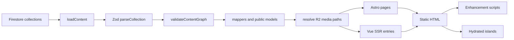
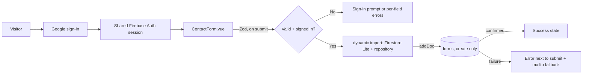
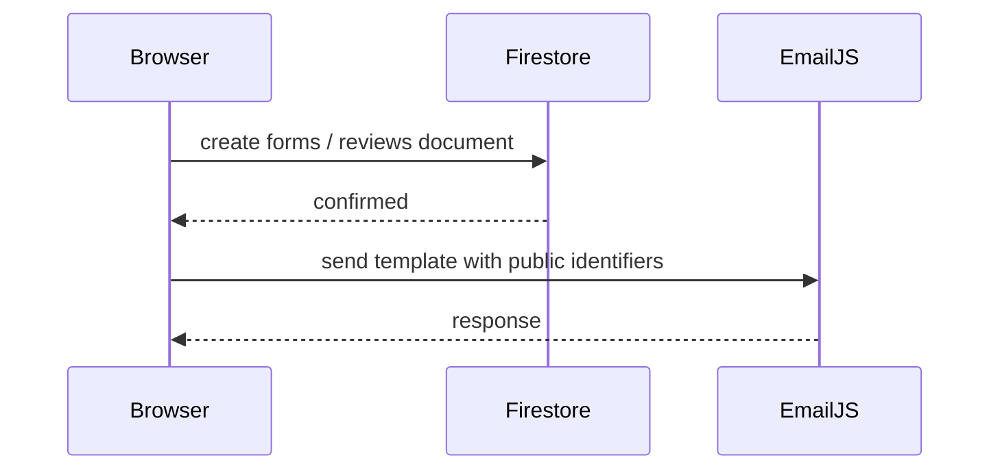
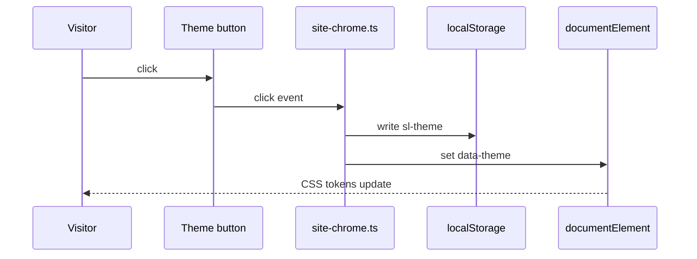

# Architecture

This document explains the rendering model behind the portfolio: why Astro owns
some surfaces, why Vue owns others, when Vue is hydrated, and how independent
islands communicate.

For the enforceable rules, see [conventions.md](conventions.md). For the
step-by-step change recipe, see [guides/adding-a-section.md](guides/adding-a-section.md).

## Context and constraints

The site is a static portfolio built with Astro, Vue 3 and Tailwind 4. Its
content model and delivery have several non-negotiable constraints:

- Editorial content lives in Cloud Firestore and is read during the build.
- Dynamic media is served from Cloudflare R2; static assets stay in the
  repository.
- Every public route must be prerendered. Public content has no runtime data
  source.
- Visitor reviews are one owner-scoped runtime surface: Google sign-in, one
  `reviews/{uid}` write, and a read of that same document. Approved public
  reviews are still resolved during the build.
- The contact form is one authenticated runtime write: one `forms` document per
  explicit submit, bound to the signed-in Google account, with no browser read.
  Messages stay private in Firestore. Contact and reviews share the same Google
  session, so signing in on one surface authenticates the other.
- The initial HTML must contain the managed content that search engines and
  readers need; content must not depend on a browser-side query.
- JavaScript should be shipped only for behaviour that needs it.
- The site supports Spanish and English, dark and light themes, keyboard
  navigation and reduced motion.

These constraints produce two independent decisions:

1. **Provenance:** is the content local to the repository or managed in
   Firestore?
2. **Interactivity:** does the surface need client state, events or browser
   APIs?

Keeping those decisions separate avoids two common mistakes: hydrating content
that only needs to be printed, and moving managed content into Astro components
that duplicate the Firestore schema.

## The two axes

### Local content and managed content

**Local content** is copy that belongs to the application: navigation labels,
hero text, service descriptions, skill definitions, form labels and UI strings.
It lives in `src/data/content.ts` and is rendered by Astro.

**Managed content** is editorial data: site sections, experience, projects,
education, certifications, articles and approved reviews. It lives in Firestore,
is validated at build time, and is rendered by Vue entries.

### Static presentation and interactive presentation

A surface may be **printed only** or **interactive**. This is independent of
provenance:

- Local content can be interactive: the hero plate, stat counters, mobile menu,
  theme toggle, skill tabs and email copy button are all local content with
  browser behaviour.
- Managed content can be printed only: articles, the blog index, stack,
  experience, education and certifications need no client JavaScript.
- Managed content can be interactive: project filters, the projects carousel
  (capped at five on the home) and the reviews expansion need client state.

The implementation therefore uses three rendering paths:

| Path | When to use it | Current examples |
| --- | --- | --- |
| Astro component | Local content, page structure, metadata, chrome | `HomePage.astro`, `HeroSection.astro`, `SiteHeader.astro`, `Layout.astro` |
| Vue SSR-only entry | Managed content that needs no client state | `StackContent.vue`, `ExperienceContent.vue`, `BlogIndexContent.vue`, `ArticleContent.vue` |
| Hydrated Vue island | Managed or local content that needs client state or browser events | `ProjectsIndexIsland.vue` (`client:load`), `ProjectsIsland.vue` (`client:visible`), `TestimonialsIsland.vue` (`client:idle`) |
| Hydrated review entry + Firebase client SDK | Google sign-in and visitor review submission | `ReviewsAccessIsland.vue`, `ReviewPanelIsland.vue` (`client:load`) |
| Hydrated contact entry + shared Google session | Google sign-in and authenticated contact submission | `ContactIsland.vue` (`client:visible`) |

## Build-time content flow

All content is resolved before a page is written:



The main entry point is `loadContent()` in `src/lib/server/content.ts`. It:

1. rejects an empty Firestore collection, except the approved `reviews` set;
2. parses every document against its Zod schema in `src/data/schemas/`;
3. validates cross-collection references with `validateContentGraph`;
4. maps documents to public models in `src/data/mappers.ts`;
5. resolves `/images/...` and `/files/...` through `PUBLIC_MEDIA_URL`;
6. rejects unresolved media paths.

Production builds reuse one validated snapshot for the whole build. Development
reads Firestore on every request. `CONTENT_SOURCE=fixture` swaps the source for
the deterministic fixture used by tests.

The browser never receives server credentials. It writes the signed-in
visitor's own review, reads that same document, and appends an authenticated
contact message to `forms`. Public content never comes from a browser query.

## Visitor reviews

Visitor reviews are a deliberate, narrow exception to the build-only data
model. They use Firebase Authentication and the Firestore Lite web SDK, and
they never read public content from the browser.

```mermaid
flowchart LR
  V[Visitor] --> A[Google sign-in]
  A --> P[Review panel]
  P -->|setDoc / updateDoc| R[(reviews/{uid}, approved=false)]
  R -->|owner getDoc| P
  M[Moderation: approved=true] --> B[Build / deploy]
  B -->|loadContent where approved==true| H[Static home, projects, experience]
```

- **Document ID:** the Firebase Auth UID enforces one review per account.
- **Public anchor:** a generated `anchorId` is used by `#review-...` links so
  the UID is not exposed in the HTML.
- **Approval:** clients always write `approved: false`; only the Admin
  SDK/Console can set it to `true`. Firestore Rules validate every field,
  reject self-approval and deny collection queries.
- **Build:** `loadContent()` queries `reviews` with
  `where('approved', '==', true)`. Pending reviews never enter the content
  graph. The collection is allowed to be empty so the first deployment can
  show the empty state and the review call to action.
- **Rebuild:** approving a review makes it eligible, but it appears on the
  static site only after the next build/deploy. The CMS/deploy hook is still a
  future integration.
- **Privacy:** the author email is stored in the review document and published
  in the approved review card as a `mailto:` link. Firestore still allows only
  the owner to read the document; the static build is what makes the email
  public. Google profile photos are validated against
  `*.googleusercontent.com`; URLs are capped at 4096 characters. Firestore
  stores only the URL, so the binary is never uploaded; the `Avatar` falls back
  to initials on load error.
- **Editorial rows:** the existing sample reviews do not carry `approved`, so
  the build query ignores them. No migration is required to hide them.

The browser therefore performs exactly three Firestore operations: a write to
its own `reviews/{uid}` document, a read of that same document, and an
append-only write to `forms` for the signed-in Google visitor. All public
review output comes from the build.

## Contact form

The home contact section is a hydrated island because it owns field state,
validation feedback, a Google session and a network write. It is still a
local-content section: its labels, validation copy and account prompt come from
`src/data/content.ts`, and its initial HTML carries the editable fields and the
neutral session shell, never a name or email.



- **Session:** `src/composables/useGoogleSession.ts` observes the same persisted
  Firebase Auth session as the review pages. Signing in or out in either surface
  applies to both; changing account uses the Google account picker.
- **Identity:** `name` and `email` are read-only values from the Google session,
  not form fields. The payload stores `senderUid`, `name`, `email`, `subject`,
  `message`, `locale` and the server timestamp.
- **Contract:** `src/data/contact.ts` owns `CONTACT_LIMITS`, the Zod schema for
  the editable draft and the issue keys. Subject and message are trimmed before
  the write.
- **Lazy write path:** `src/lib/forms/` and Firestore Lite are not imported
  statically; the dynamic import happens inside the submit handler. The shared
  session composable only resolves Auth after the island hydrates.
- **Rules:** `forms` accepts only `create` from a verified Google account. The
  rules require `request.auth.token.firebase.sign_in_provider == 'google.com'`,
  `senderUid == request.auth.uid` and `email == request.auth.token.email`, and
  validate the documented fields, lengths, locale and a recent server
  timestamp. `get`, `list`, `update` and `delete` are denied; the Admin SDK and
  the Console remain the only readers. Messages are PII and are never rendered
  by the static site.
- **Spam:** Zod and rules constrain the payload, not the rate. App Check and
  usage alerts are the intended defences; an authenticated account can still
  submit repeatedly, so rate limiting needs App Check or a backend.

## Email notifications

Contact and new-review emails are best effort and happen after the Firestore
write. They are sent with EmailJS from the browser; there is no notification
server.



- **Client:** `src/lib/notifications/emailjs.ts` builds the template variables
  and calls EmailJS. It is imported dynamically on submit and uses only the
  public key, service and template IDs.
- **Visibility:** `PUBLIC_EMAILJS_*` values appear in the compiled JavaScript
  and in browser requests. They are public identifiers, not secrets; the
  private key is never shipped.
- **Failure:** a missing configuration or provider error never repeats the write
  or changes the success state. Firestore remains the record of truth.

## Astro shell

Astro owns the document and the route boundaries:

- `src/layouts/Layout.astro` writes the `<head>`, canonical URL, alternate
  locales, initial theme script and global scripts.
- `src/pages/` defines the Spanish and English routes.
- Page-level Astro components (`HomePage.astro`, `ProjectsPage.astro`,
  `BlogPage.astro`, `ArticlePage.astro`) compose the sections and pass managed
  data to Vue entries.
- `src/components/chrome/astro/` owns the header, footer, locale switch and
  theme toggle.

Astro also owns SEO metadata even when the values come from Firestore. Article
titles, descriptions, canonical URLs and alternates are computed in the Astro
route so the `<head>` is complete before any Vue code runs. `Layout.astro`
renders Open Graph, Twitter Cards, the robots meta tag and the page JSON-LD.
`src/lib/seo.ts` builds the structured-data graph (`WebSite`, `Person`,
`ProfilePage`, `BlogPosting`, `CollectionPage`, `BreadcrumbList`).

The sitemap is generated at build time by `src/pages/sitemap-0.xml.ts` from the
same validated `loadContent()` snapshot. It includes only canonical, indexable
URLs, uses `updatedAt` as `lastmod` for articles and emits `xhtml:link`
alternates for bilingual pages. `sitemap-index.xml` remains the public entry
point referenced by `robots.txt` and `Layout.astro`.

## Vue entries and islands

`src/components/islands/` is the only place from which an Astro file may import
a `.vue` component. The directory is a **module boundary**, not a hydration
boundary: an entry can be SSR-only or hydrated.

Hydrated entries are wrapped with `withIslandContext` from
`src/lib/withIslandContext.ts`. SSR-only, prop-driven entries may export their
view directly. The wrapper:

- receives `locale`, `page`, `path` and `content` props;
- provides page preferences and a route object to that Vue root;
- forwards Astro-rendered slots to the Vue component.

Each hydrated island is a separate Vue root. There is no shared Vue application
instance, no cross-island store contract and no direct island-to-island event
bus.

### Naming

- `*Island.vue` — an entry that is hydrated with a `client:*` directive.
- `*Content.vue` — an entry that is rendered by Vue only during the build.
- Other feature components live under `src/components/<feature>/vue/` and are
  imported by an entry, not by Astro.

## Hydration policy

Hydration is opt-in per entry. The smallest directive that satisfies the
interaction wins:

| Directive | Use it for | Current use |
| --- | --- | --- |
| none | HTML that needs no client state | Articles, blog index, stack, experience, education, certifications, blog teaser |
| `client:load` | Interaction that must be ready immediately | Projects index filter, review access and review panel |
| `client:visible` | Interaction below the fold | Home projects carousel (capped at five) and details |
| `client:idle` | Non-critical interaction after first paint | Reviews expansion and deep-link handling |
| `client:only` | Not used | Avoid it: it gives up server HTML and SEO |

The decision is driven by behaviour, not by framework preference. A component
that only prints managed content stays SSR-only. A component that needs state
gets the least eager directive that still feels correct.

## Composition and slots

Astro can pass children to a Vue component. `withIslandContext` forwards those
children to the Vue component's slots, including named slots. This supports an
interactive Vue shell that receives static, Astro-rendered content.

The pattern is appropriate when:

- the shell needs client behaviour;
- the children are static presentation that Astro can render once;
- passing serialised data would be more awkward than passing markup.

It is not appropriate for content that Vue must transform or for Firestore
records: pass those as typed props. A `.vue` file must never import an `.astro`
file.

After the header and footer moved to Astro, no shipped section currently uses
slot forwarding. The capability remains supported and is covered by
`tests/islands.test.ts`; treat it as an available composition tool, not as the
default way to compose every section.

## Communication between independent islands

Because islands are separate Vue roots, the durable communication channels are
outside Vue:

### Theme

- `localStorage["sl-theme"]` stores the visitor's choice.
- The inline script in `Layout.astro` applies `data-theme` and `color-scheme`
  before first paint, preventing a flash.
- `src/stores/theme.ts` owns theme reads, writes and system-preference
  following for the code that runs in the browser.
- `src/scripts/site-chrome.ts` binds every `[data-theme-toggle]` button to the
  theme store.
- CSS and `data-theme` are the cross-island contract. Vue components do not
  need to read a shared theme object to render correctly.



### Locale and reading position

- Locale is encoded in the URL: Spanish at `/`, English under `/en/...`.
- `LocaleSwitch.astro` renders the localized links. `src/scripts/site-chrome.ts`
  writes `sl-locale-scroll` to `sessionStorage` and appends the current hash
  before the navigation.
- `src/scripts/locale-scroll.ts` restores the vertical offset after load.
- Locale changes are real navigations, so Astro can emit the correct document,
  metadata and content for the new language.

### Hash, sections and deep links

- The URL hash is the shared navigation state.
- `src/scripts/site-chrome.ts` keeps the header navigation in sync with the
  visible section and rewrites the hash with `history.replaceState`.
- `src/router/scrollControl.ts` lets a component temporarily pause that rewrite
  while a deep-link scroll is in progress.
- `provideRoute` listens for `hashchange`, so Vue components see native anchor
  navigation.
- `TestimonialsSection.vue` expands hidden review cards before scrolling to a
  `#review-...` target.

### Props

Astro passes data to entries as serialised props. Treat them as read-only. If a
component needs to change state, derive it locally with `computed`, use a local
`ref`, or use a `defineModel` contract inside the Vue tree.

## Progressive enhancement scripts

`src/scripts/` contains framework-free enhancements for Astro-rendered
surfaces: header navigation, theme controls, locale scroll restoration, stat
counters, the identity plate, skill tabs, email copy and article navigation.

Scripts follow the same contract:

- select behaviour hooks with `data-*` attributes, not presentation classes;
- leave the server HTML intact when JavaScript is unavailable;
- guard browser APIs and `prefers-reduced-motion`;
- clean listeners and observers on `pagehide` when they own long-lived work;
- do not touch nodes inside `astro-island`; Vue owns those subtrees.

`src/scripts/reveal.ts` explicitly skips `astro-island` so the static reveal
system and Vue's own reveal composables do not fight over the same element.

## Data contracts

- Schemas live in `src/data/schemas/` and use Zod.
- `parseCollection` validates a Firestore collection.
- `validateContentGraph` checks stable references between records.
- `src/data/mappers.ts` converts editorial documents into the public models
  consumed by Astro and Vue. `toPublicTestimonial` keeps the author email,
  which is published in the review card, while stripping approval, ownership
  and ordering fields.
- `src/data/reviews.ts` shares review limits, draft validation, initials,
  photo normalization and ordering between the browser and the build.
- `src/data/relations.ts` resolves project, experience and review links in both
  directions.
- `src/data/anchors.ts` defines the stable deep-link IDs. Reviews use the public
  `anchorId`, not the Firebase UID.
- `src/lib/server/fixtures.ts` supplies deterministic content for tests.
- `src/lib/firebase/` contains the lazy browser SDK entry points.
- `src/lib/reviews/` contains auth, the owner-only repository, error mapping and
  the session/draft/submission composables.
- `firestore.rules` is the security boundary for visitor writes. It documents
  the review model and is deployed with `firebase deploy --only
  firestore:rules`.

Editorial contact details are validated but stripped by `toPublicTestimonial`
before HTML or island props are generated.

## Routing, internationalization and SEO

- Spanish is the default route without a prefix; English is under `/en`.
- Each locale uses its own route vocabulary: `/proyectos/` ↔ `/en/projects/`,
  `/resenas/` ↔ `/en/reviews/`, `/resenas/panel/` ↔ `/en/reviews/panel/`.
  Blog segments are shared (`/blog/` ↔ `/en/blog/`), and articles keep one
  editorial slug in both languages.
- Every public URL ends with a slash. `astro.config.mjs` sets
  `trailingSlash: 'always'`; the eventual hosting platform must mirror it.
- `src/data/paths.ts` owns the canonical paths and `alternateLocalePath`, which
  maps a page to the other locale. The locale switch, `hreflang` alternates and
  `toHref` use it instead of assuming that `/en` is the only difference.
- `src/router/astroRouter.ts` provides `toHref` and `RouterLink` for Vue
  components so links stay localized. Named destinations include articles.
- `Layout.astro` emits canonical, `hreflang`, `x-default`, Open Graph, Twitter
  Cards and the robots meta tag.
- `src/lib/seo.ts` builds the per-page JSON-LD graph. Article pages also render
  a visible breadcrumb in `ArticleView.vue`; the breadcrumb labels and URLs are
  reused by `BreadcrumbList`.
- Translated content carries a `lang` attribute.
- `/projects` redirects to `/proyectos/`; `/en/proyectos/`, `/en/resenas/` and
  `/en/resenas/panel/` redirect to the current English routes. The canonical
  public routes are `/`, `/proyectos/`, `/blog/`, `/blog/:slug/`, their
  `/en` counterparts and the review utility routes.
- `/resenas/`, `/resenas/panel/`, `/en/reviews/` and `/en/reviews/panel/` are
  interactive utility routes. They are `noindex, follow`, are not in the
  sitemap and are not treated as public content.
- Article routes are generated only for the locales that have a translation, so
  an article cannot produce a fallback duplicate in the other language.
- Blog indexes are scoped to their locale. An article without a translation
  appears only in the blog index of the language that exists; no fallback route
  or cross-language card is generated.
- SEO values that come from Firestore are still computed in Astro page
  components, not in Vue.

## Testing model

The test suite mirrors the architecture:

- `tests/architecture.test.ts` — import boundary, provenance split, naming,
  no-hydration guarantees, no Firebase in public content features and review
  route sitemap exclusion.
- `tests/reviews.test.ts` — review schema, public projection, draft validation,
  helpers and Firebase error mapping.
- `tests/contact.test.ts` — contact schema, limits, trimming, payload building,
  session identity, error mapping and rules alignment.
- `tests/notifications.test.ts` — notification payloads, dynamic EmailJS
  loading and the public-identifier contract.
- `tests/browser.test.ts` — no-JavaScript HTML, hydration, project filters,
  theme persistence, locale navigation, deep links, keyboard access, article
  reading aids, review shells and the unauthenticated redirect.
- `tests/islands.test.ts` — per-island context and slot forwarding.
- `tests/navigation.test.ts` — localized link generation.
- `tests/content.test.ts` and `tests/fixtures.test.ts` — public data contracts,
  approved-only review output and fixture validity.

Browser tests build with `CONTENT_SOURCE=fixture` and `PUBLIC_MEDIA_URL`, then
serve the static output. That build must not be deployed.

## Tradeoffs and non-goals

### Tradeoffs

- Managed content ships as Vue-rendered HTML even when it has no client
  behaviour. This keeps one rendering path for Firestore data and preserves
  the HTML/SEO guarantee, at the cost of a Vue SSR pass during the build.
- Islands do not share reactive state. This keeps bundles and ownership
  isolated, but cross-island coordination must go through storage, the DOM or
  the URL.
- Local interactive surfaces use scripts instead of Vue. This avoids hydration
  cost, but the script must manage its own listeners and cleanup.
- Visitor reviews add a browser-side Firebase SDK and make Firestore Rules a
  security boundary. This is the cost of keeping the site static and avoiding
  a custom server. The contact form shares the same Auth session, so the home
  loads Firebase Auth only after the contact island becomes visible; Firestore
  Lite still loads per submit. The form is an authenticated write surface whose
  only client-side control is Zod; rate limiting needs App Check or a backend.
- Approval is asynchronous with respect to the static site: a review appears
  after the next build/deploy.

### Non-goals

- No runtime Firestore queries for public content.
- No client-side content fetching for primary content.
- No `client:only` rendering for public content.
- No shared global Vue store across islands.
- No automatic state synchronisation between every island.
- No client read of another visitor's review and no client approval flag.
- No admin/CMS review UI. Approval is a manual Firestore/Admin SDK operation
  until the planned CMS exists.

## Future CMS and deploy hook

The planned CMS at `/admin` is **not implemented**. It is an architectural
intention, not a current route or a dependency of the static site.

The intended publishing flow is:

```text
visitor writes reviews/{uid} with approved=false
        ↓
editor reviews the pending document
        ↓
editor sets approved=true (and optionally order)
        ↓
CMS calls the hosting deploy hook
        ↓
the hosting provider rebuilds the Astro site
        ↓
loadContent() queries approved reviews and validates the graph
        ↓
new static HTML is published
```

This keeps the browser free of public Firestore reads, keeps the public site
static and makes the build the only place where editorial data is resolved. Any
future `/admin` implementation must preserve that boundary: it may write to
Firestore and trigger a build, but it must not turn public pages into runtime
data consumers. Until then, approval is a manual Firestore Console step
documented in the README.

`src/lib/server/r2.ts` is server-only scaffolding for a future media CRUD. It is
not used by the current build and should not be imported from client code.
